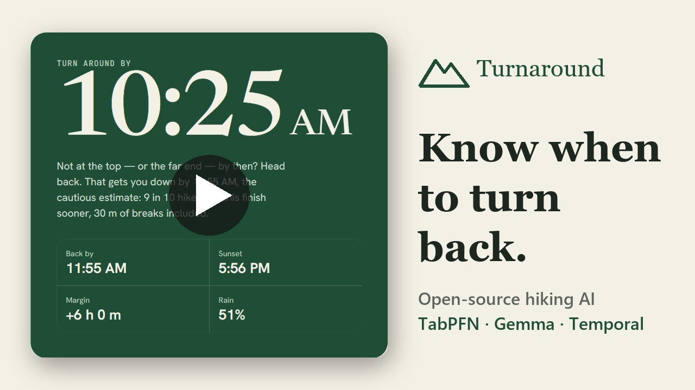
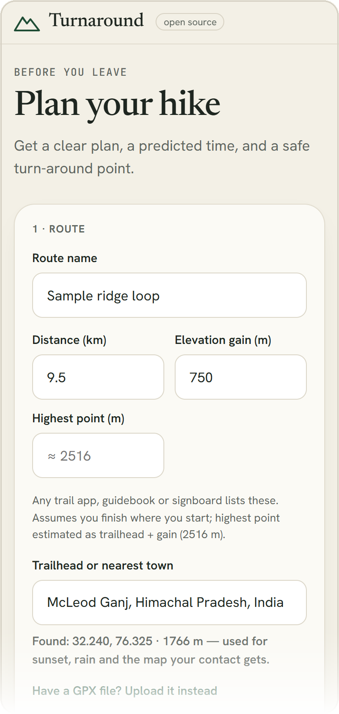
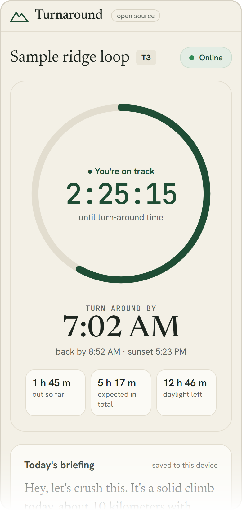
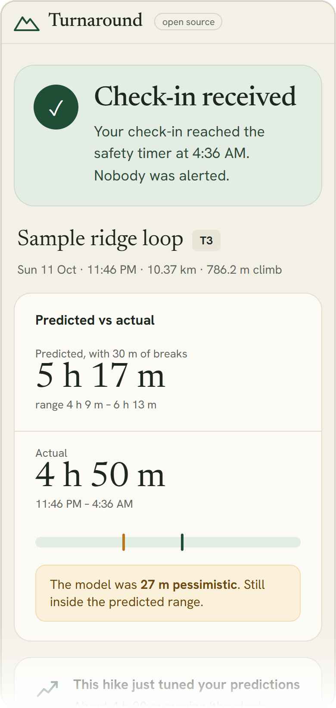
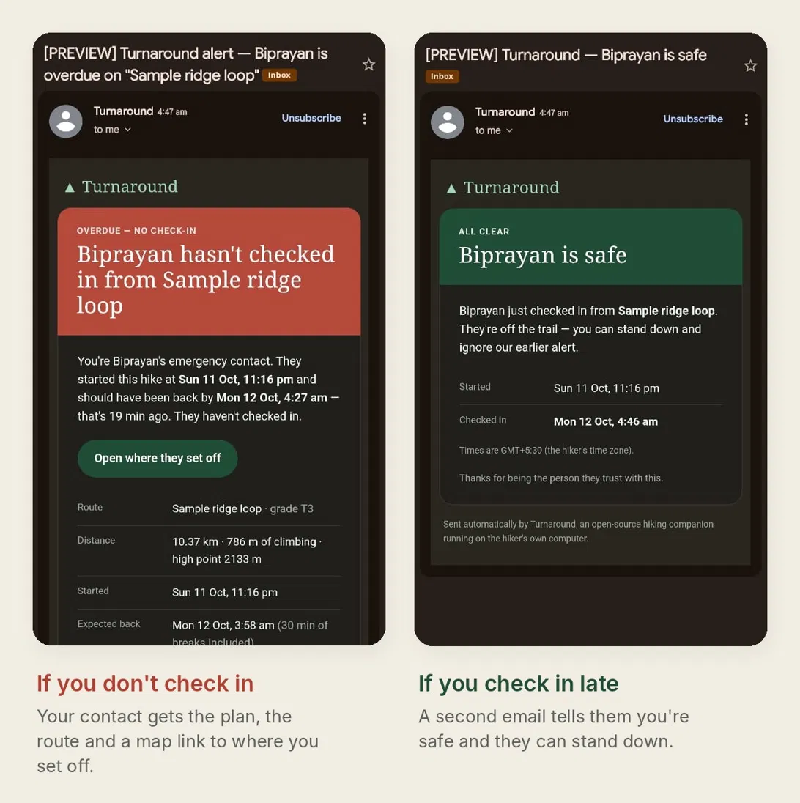
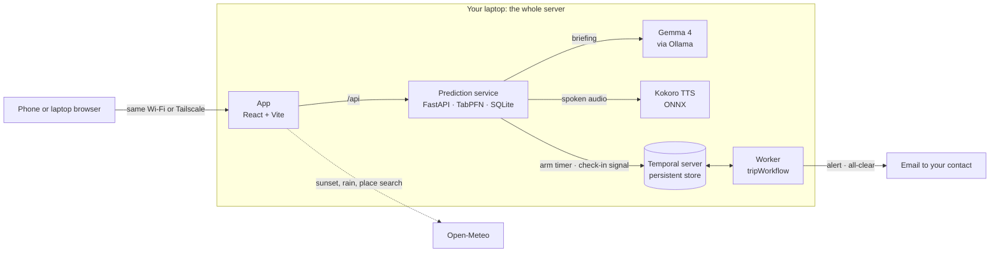

<p align="center">
  <picture>
    <source media="(prefers-color-scheme: dark)" srcset="docs/brand/logo-dark.png">
    
  </picture>
</p>

<h3 align="center">Know when to turn back.</h3>

<p align="center">
  An open-source hiking companion that predicts your time, sets your turn-around point,<br>
  and quietly alerts someone you trust if you don't check in. It all runs on your own laptop.
</p>

<p align="center">
  <a href="https://github.com/CodeNeuron58/Turnaround/actions/workflows/ci.yml"></a>
  
  
  <a href="https://dev.to/challenges/hacktoberfest-week1-2026-10-05"></a>
</p>

<p align="center">
  <a href="https://youtu.be/eOzc_RNBzMk"></a><br>
  <sub>▶ <a href="https://youtu.be/eOzc_RNBzMk">Watch the 30-second demo</a></sub>
</p>

## How it works

<table>
  <tr>
    <td width="33%" valign="top"></td>
    <td width="33%" valign="top"></td>
    <td width="33%" valign="top"></td>
  </tr>
  <tr>
    <td valign="top"><b>1 · Plan</b><br>Distance, climb and trailhead. No GPX needed. Get a turn-around time checked against sunset.</td>
    <td valign="top"><b>2 · Go</b><br>A spoken briefing, a countdown to turn around, and a safety timer quietly watching.</td>
    <td valign="top"><b>3 · Check in</b><br><i>Hike complete</i> or <i>I turned back</i>. Miss it, and your contact gets an email with a map.</td>
  </tr>
</table>

## What your contact gets

<p align="center">
  
</p>

## Built with

| Open-source piece | What it does |
|---|---|
| **TabPFN** | Predicts your moving time from 7,186 real hikes, then tunes it to your pace |
| **Gemma 4** | Writes your trail briefing, locally through Ollama |
| **Kokoro** | Reads it aloud, an open 82M-parameter voice running on ONNX |
| **Temporal** | Runs the safety timer, which survives crashes and restarts |
| **Open-Meteo · Brevo** | Sunset, rain and place search · the alert email |

## Results

| | Naismith's rule | TabPFN |
|---|:---:|:---:|
| Average error on 1,438 unseen hikes | 44.1 min | **34.8 min** |
| Hikers back before the *back-by* time | — | **90.4%** <sub>(target 90%)</sub> |

The safety timer is proven in five scenarios: on-time check-in, a mail outage, the worker killed mid-trip, a missed-check-in drill, and the Temporal server killed mid-trip. **[See the evidence →](docs/evidence/)**

<details>
<summary><b>Run it locally</b></summary>

<br>

Node 20+, Python 3.11, [Ollama](https://ollama.com) with `gemma4:e4b`, and the Kokoro + Temporal files from [tools/README.md](tools/README.md). Training data: [data/DATA_NOTES.md](data/DATA_NOTES.md).

```bash
npm install
python -m venv .venv && .venv\Scripts\pip install -r prediction\requirements.txt
python prediction\build_dataset.py
```

One terminal each:

```bash
tools\temporal\temporal.exe server start-dev --port 7233 --db-filename tools\temporal\turnaround.db
.venv\Scripts\python.exe -m uvicorn prediction.service:app --port 8000
npm run worker -w @turnaround/workflows
npm run dev -w @turnaround/app        # → http://localhost:5173
```

Optional: real alert emails with a free [Brevo](https://www.brevo.com) key in `.env` (see `.env.example`). Your past hikes can seed your pace factor with `prediction\import_hikes.py`.

</details>

<details>
<summary><b>How it fits together</b></summary>

<br>



| Folder | What's inside |
|---|---|
| [`app/`](app/) | The three screens: React + Vite |
| [`prediction/`](prediction/) | TabPFN service, trip rules, trip storage |
| [`workflows/`](workflows/) | The Temporal safety timer and the emails |
| [`agent/`](agent/) | The same plan as a command-line agent |
| [`docs/`](docs/) | Evidence, screenshots, design |

</details>

<details>
<summary><b>Taking it on the trail</b></summary>

<br>

- **Reach the laptop from your phone:** same Wi-Fi works out of the box. On mobile data, put both on a private network such as [Tailscale](https://tailscale.com). Don't use a public tunnel, because the app has no login.
- **Keep the laptop awake and online:** it runs the timer and sends the email.
- **Plan while you have signal:** the briefing and its audio are saved to your phone. With no signal, your check-in waits on the phone and sends when it can.
- **Run a drill:** open `http://…:5173/?drill=120` and the alert fires 2 minutes after Start. Both emails are marked `[DRILL]`.

</details>

<details>
<summary><b>Tests</b></summary>

<br>

```bash
python -m unittest discover -s prediction/tests -t .     # trip rules (stdlib only)
npm test -w @turnaround/agent                            # the agent's turn-around rule
.venv\Scripts\python.exe tests\smoke_stack.py --briefing # end to end, against a scratch database
```

CI runs the typechecks, the app build and both unit suites on every push.

</details>

---

<p align="center">
  <sub>MIT licensed · training data: hikr.org tracks via Kaggle (CC0) · built for the <a href="https://dev.to/challenges/hacktoberfest-week1-2026-10-05">DEV Hacktoberfest Open-Source AI Challenge</a></sub>
</p>
